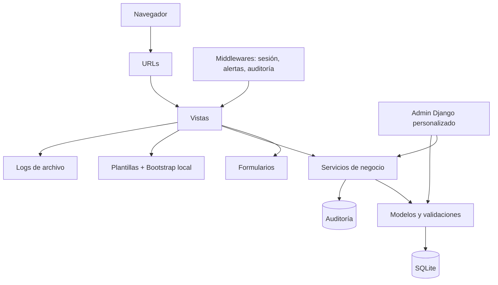
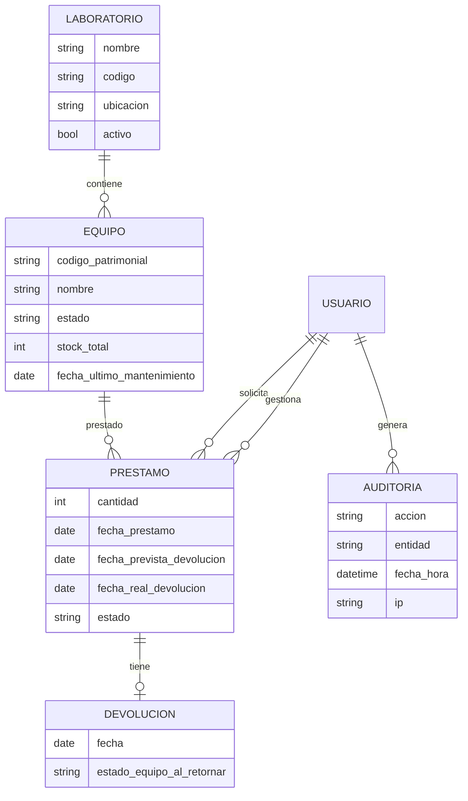
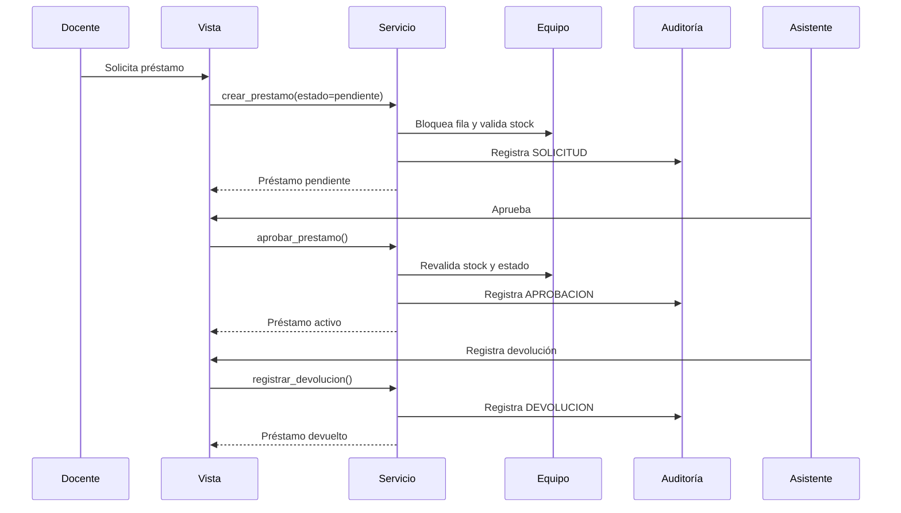
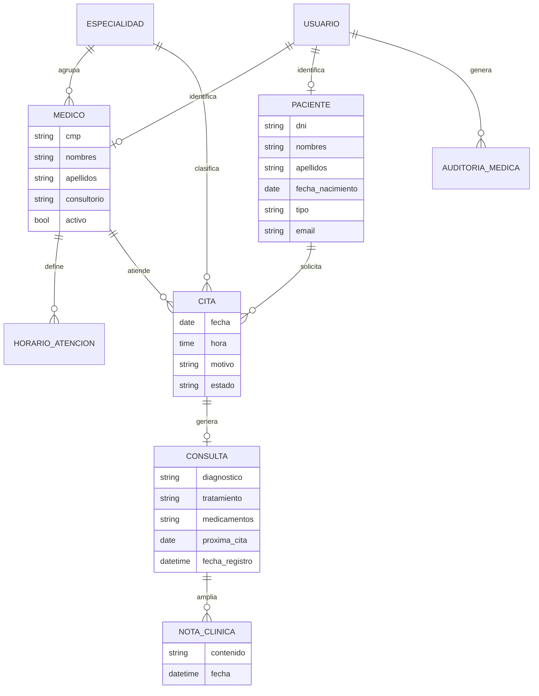
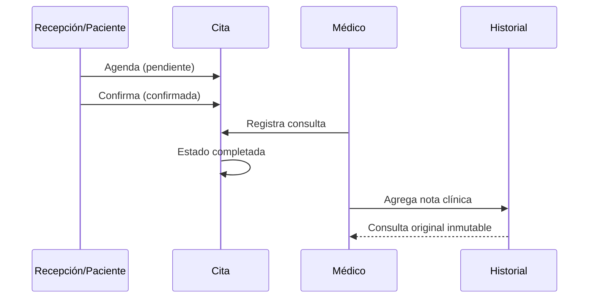
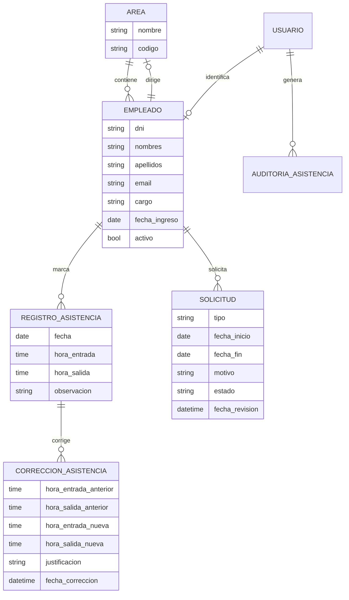
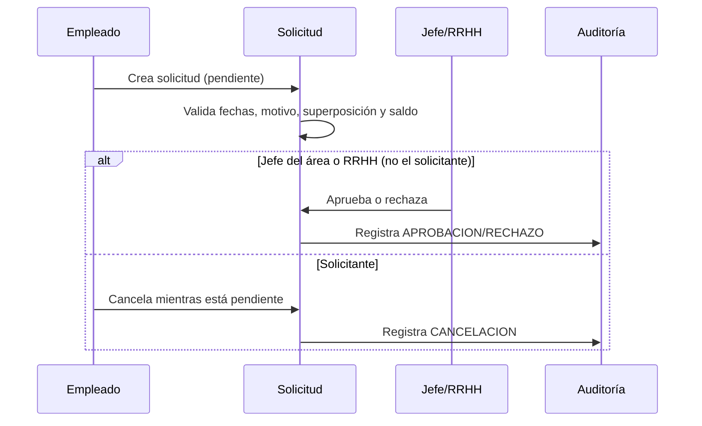
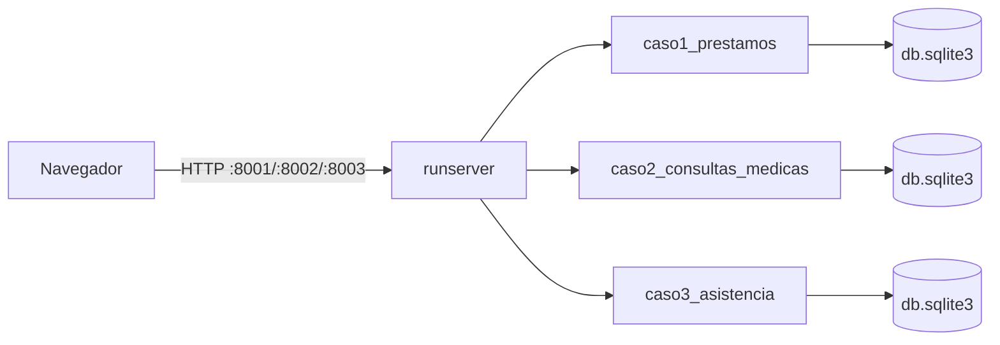

# Documentación técnica · Práctica Semana 12 (IS093A)

Este documento describe la arquitectura, los modelos, las reglas de negocio, la seguridad y la
operación de los tres sistemas Django desarrollados. Está alineado con el código del repositorio
y con los resultados de pruebas registrados en [`RESULTADOS_PRUEBAS.md`](RESULTADOS_PRUEBAS.md).

---

## 1. Visión general

| Caso | Dominio | Aplicación Django | Puerto |
|---|---|---|---|
| 1 | Préstamos de equipos de laboratorio | `prestamos` | 8001 |
| 2 | Consultas médicas y agenda | `consultas` | 8002 |
| 3 | Asistencia, permisos y vacaciones | `asistencia` | 8003 |

Cada caso es un proyecto **independiente**, con su propio `manage.py`, configuración, base SQLite,
plantillas, estáticos, migraciones, datos demo y pruebas. No comparten base de datos ni procesos.

### Stack

- Python 3.12+ (ejecución validada con Python 3.13).
- Django 5.2 LTS.
- SQLite con `timeout` de 20 segundos.
- Bootstrap 5.3.3 local (CSS y bundle JS).
- HTML5 + CSS propio, sin frameworks SPA.
- Backend de correo de consola.
- Logs en archivo y consola.

### Principios de diseño

1. **Reglas en el servidor**: modelos, formularios, servicios y vistas revalidan.
2. **Servicios transaccionales**: operaciones críticas usan `transaction.atomic()` y bloqueo.
3. **Autorización por rol y por objeto**: no basta con el menú; se valida cada recurso.
4. **Auditoría**: acciones sensibles y respuestas 403 quedan registradas.
5. **Datos ficticios**: los comandos demo son idempotentes y no usan información real.
6. **Operación local**: sin servicios externos obligatorios.

---

## 2. Arquitectura



Capas:

- **Presentación**: plantillas Django, Bootstrap local, CSS propio, mensajes.
- **Aplicación**: vistas finas que delegan reglas a formularios/servicios.
- **Dominio**: modelos con `clean()`, propiedades calculadas y restricciones SQL.
- **Infraestructura**: SQLite, logging, correo de consola, archivos estáticos.

---

## 3. Estructura común

```
casoN_*/
├── config/
│   ├── settings.py      # configuración, sesión, logging, seguridad
│   ├── urls.py          # rutas raíz + handler403
│   ├── asgi.py
│   └── wsgi.py
├── <app>/
│   ├── migrations/
│   ├── management/commands/crear_datos_demo.py
│   ├── admin.py
│   ├── forms.py
│   ├── middleware.py
│   ├── models.py
│   ├── permissions.py
│   ├── services.py
│   ├── tests.py
│   ├── urls.py
│   ├── utils.py
│   ├── validators.py
│   └── views.py
├── static/
│   ├── css/estilos.css
│   └── vendor/bootstrap.*
├── templates/
├── logs/
├── manage.py
├── requirements.txt
├── .gitignore
└── README.md
```

---

## 4. Caso 1 · Préstamos de equipos

### 4.1 Contexto

Biblioteca/laboratorio universitario que presta equipos a docentes. El asistente administra la
ventanilla; el docente solicita; el administrador supervisa; el invitado solo consulta.

### 4.2 Modelo entidad-relación



### 4.3 Reglas y su ubicación

| Regla | Implementación |
|---|---|
| Máximo 3 préstamos activos | `Prestamo.clean()`, `services._validar_docente_y_cupo()`, prueba dedicada |
| Fechas coherentes | `Prestamo.clean()`, `CheckConstraint prestamo_fechas_coherentes` |
| Solo equipos operativos | `Prestamo.clean()`, `services.crear_prestamo()` |
| Stock suficiente | `Equipo.cantidad_disponible`, `clean()`, servicio con `select_for_update()` |
| Devolución única | `Devolucion` 1:1 + `services.registrar_devolucion()` |
| No eliminar con préstamos | `services.eliminar_equipo()` |
| Sanitización | `validators.sanitizar_texto()`, `validar_sin_html()` |
| Sesión 30 min | `settings.SESSION_TIMEOUT`, `ActividadSesionMiddleware` |
| Auditoría | `Auditoria`, `utils.registrar_auditoria()`, `AuditoriaMiddleware` |

### 4.4 Flujo de préstamo



### 4.5 Admin

- Filtros por estado, laboratorio, fechas y docente.
- Préstamos vencidos resaltados; devoluciones en solo lectura.
- Auditoría en solo lectura.
- Acciones y enlaces a reportes.

---

## 5. Caso 2 · Consultas médicas

### 5.1 Contexto

Centro médico universitario. Recepción agenda; el médico atiende y registra la consulta; el
paciente consulta su historial; el admin supervisa. La información clínica está separada de la
gestión administrativa.

### 5.2 Modelo entidad-relación



### 5.3 Horarios

| Día | Atención |
|---|---|
| Lunes a viernes | 08:00 – 18:00 |
| Sábado | 08:00 – 13:00 |
| Domingo | Cerrado |

- Duración de franja: `CITA_DURACION_MINUTOS` (30 por defecto).
- La cita debe caber completa antes del cierre.
- El médico debe tener un `HorarioAtencion` que cubra la franja.
- No se permiten horarios de médico superpuestos.

### 5.4 Reglas y su ubicación

| Regla | Implementación |
|---|---|
| DNI 8 dígitos | `validators.validar_dni`, `Paciente.clean()` |
| CMP 5 dígitos | `validators.validar_cmp`, `Medico.clean()` |
| Nacimiento no futuro | `Paciente.clean()` |
| Correo `@uncp.edu.pe` | `validar_correo_institucional()` para estudiantes |
| Motivo ≥ 20 | `MinLengthValidator`, `Cita.clean()` |
| Horario institucional | `horarios.validar_horario_general()` |
| Horario del médico | `horarios.validar_horario_medico()` |
| Sin superposición | `Cita.clean()` + constraint condicional |
| Una cita activa por día | `Cita.clean()` + constraint condicional |
| Consulta inmutable | `Consulta.save()` bloquea actualizaciones |
| Historial autorizado | `permissions.puede_ver_historial()` |
| Sesión 20 min | `settings.SESSION_TIMEOUT`, middleware |
| Auditoría | `AuditoriaMedica`, `middleware`, `utils` |

### 5.5 Flujo de atención



### 5.6 Privacidad

- La recepción puede ver pacientes y citas, pero **no** diagnósticos, tratamientos ni notas.
- El médico solo accede al historial si tiene `ver_historial_clinico` y relación asistencial
  (cita confirmada/completada o consulta previa).
- Cada acceso a historial se audita con usuario, paciente, IP y recurso.
- El paciente solo ve su propio historial.

---

## 6. Caso 3 · Asistencia y permisos

### 6.1 Contexto

Empresa con áreas y jefaturas. RRHH controla la asistencia; los jefes aprueban permisos de su
equipo; los empleados marcan y solicitan; el contador revisa horas y extras.

### 6.2 Modelo entidad-relación



### 6.3 Cálculo de horas

```
horas_trabajadas = salida - entrada
horas_extra = max(horas_trabajadas - 8, 0)
```

Se calculan en propiedades del modelo (`total_horas`, `total_extra`) y no se almacenan, evitando
inconsistencias cuando se corrige un registro.

### 6.4 Reglas y su ubicación

| Regla | Implementación |
|---|---|
| DNI 8 dígitos único | `validar_dni`, `Empleado.clean()`, campo único |
| Correo `@tecnoandes.pe` | `validar_correo_corporativo()` |
| Fecha de ingreso no futura | `Empleado.clean()` |
| Una marcación por día | `UniqueConstraint asistencia_unica_por_dia` |
| Salida > entrada | `RegistroAsistencia.clean()`, servicio |
| Extra > 8 h | `reglas.horas_extra()` |
| Solo RRHH corrige | `permissions.puede_corregir()`, `services.corregir_asistencia()` |
| Justificación ≥ 50 | `CorreccionAsistencia.clean()`, servicio |
| Corrección inmutable | `CorreccionAsistencia.save()` |
| Inicio en día hábil | `Solicitud.clean()`, `reglas.es_dia_habil()` |
| Motivo ≥ 20 | `Solicitud.clean()` |
| Sin superposición | `Solicitud.clean()` |
| Saldo 30 días | `Empleado.saldo_disponible()`, `dias_por_anio()` |
| Aprobación jefe/RRHH | `permissions.puede_resolver_solicitud()` |
| Sin autoaprobación | `puede_resolver_solicitud()` compara empleado |
| Alcance por área | `empleados_visibles`, `registros_visibles`, `solicitudes_visibles` |
| Sesión 45 min | `settings.SESSION_TIMEOUT`, middleware |

### 6.5 Flujo de solicitud



### 6.6 Alcance por área

| Rol | Empleados | Registros | Solicitudes |
|---|---|---|---|
| RRHH / Admin | Todos | Todos | Todas |
| Jefe | Su área | Su área | Su área |
| Empleado | Solo él | Solo él | Solo él |
| Contador | Todos (lectura) | Todos (lectura) | Todas (lectura) |

---

## 7. Seguridad transversal

### 7.1 Sesiones

| Caso | Inactividad | Implementación |
|---|---|---|
| 1 | 30 minutos | `SESSION_TIMEOUT` + `ActividadSesionMiddleware` |
| 2 | 20 minutos | `SESSION_TIMEOUT` + `ActividadSesionMiddleware` |
| 3 | 45 minutos | `SESSION_TIMEOUT` + `ActividadSesionMiddleware` |

El middleware compara la marca `ultima_actividad` con la hora actual. Si expira, cierra la sesión
y redirige al login con un mensaje (`?expirada=1`).

### 7.2 Cookies y cabeceras

- `SESSION_COOKIE_HTTPONLY = True`
- `CSRF_COOKIE_HTTPONLY = True`
- `SameSite = Lax`
- `X_FRAME_OPTIONS = DENY`
- `SECURE_CONTENT_TYPE_NOSNIFF = True`
- `SECURE_REFERRER_POLICY = same-origin`
- `SESSION_EXPIRE_AT_BROWSER_CLOSE = True`

### 7.3 HTTPS en producción

```powershell
$env:DJANGO_DEBUG="0"
$env:DJANGO_SECRET_KEY="<clave-larga-y-aleatoria>"
$env:DJANGO_ALLOWED_HOSTS="dominio.example"
$env:DJANGO_SECURE_COOKIES="1"
$env:DJANGO_SSL_REDIRECT="1"
```

Con esas variables se activan cookies `Secure`, redirección HTTPS y HSTS.

### 7.4 Auditoría

| Caso | Modelo | Eventos |
|---|---|---|
| 1 | `Auditoria` | login, logout, login fallido, solicitud, aprobación, rechazo, devolución, equipo, acceso denegado |
| 2 | `AuditoriaMedica` | agendar, cancelar, confirmar, consulta, nota, historial, agenda, login/logout, acceso denegado |
| 3 | `AuditoriaAsistencia` | marcación, corrección, solicitud, aprobación, rechazo, cancelación, login/logout, acceso denegado |

Los logs de archivo se ubican en `logs/` y no registran contraseñas ni cuerpos completos.

### 7.5 Validación y sanitización

- Todos los textos visibles pasan por `sanitizar_texto()`.
- Se rechaza HTML en observaciones, motivos, justificaciones y notas.
- Los formularios usan validadores de Django y validaciones de dominio.
- Las operaciones críticas revalidan dentro de la transacción.

---

## 8. Base de datos y migraciones

Cada caso tiene una migración inicial `0001_initial.py` que incluye modelos, índices y
restricciones. Comandos de verificación:

```powershell
python manage.py makemigrations --check --dry-run
python manage.py migrate
python manage.py showmigrations
```

Restricciones destacadas:

- Caso 1: stock positivo, cantidad positiva, fechas coherentes.
- Caso 2: cita única por médico/franja activa y por paciente/día activo.
- Caso 3: registro único por empleado/día, fechas coherentes de solicitud.

---

## 9. Operación

### 9.1 Comandos útiles

```powershell
python manage.py check
python manage.py test <app> -v 2
python manage.py crear_datos_demo
python manage.py createsuperuser
python manage.py collectstatic
python manage.py runserver 8001
```

### 9.2 Variables de entorno

| Variable | Efecto |
|---|---|
| `DJANGO_SECRET_KEY` | Clave secreta de producción. |
| `DJANGO_DEBUG` | `0` desactiva DEBUG. |
| `DJANGO_ALLOWED_HOSTS` | Lista separada por comas. |
| `DJANGO_SECURE_COOKIES` | `1` activa cookies Secure y HSTS. |
| `DJANGO_SSL_REDIRECT` | `1` redirige a HTTPS. |
| `DEMO_PASSWORD` | Contraseña de usuarios demo. |
| `CITA_DURACION_MINUTOS` | Duración de franja (caso 2). |
| `JORNADA_HORAS` | Jornada base (caso 3). |
| `SALDO_ANUAL_DIAS` | Saldo anual (caso 3). |
| `JUSTIFICACION_MINIMA` | Mínimo de justificación (caso 3). |

### 9.3 Despliegue

La práctica se ejecuta con `runserver` en local. Para un despliegue real:

1. Usar un servidor WSGI/ASGI (Gunicorn, Waitress o similar).
2. Servir estáticos con el servidor web o WhiteNoise.
3. Cambiar SQLite por PostgreSQL si hay concurrencia.
4. Definir `DJANGO_DEBUG=0`, clave secreta y hosts permitidos.
5. Activar HTTPS y copias de seguridad.
6. Revisar `python manage.py check --deploy`.

---

## 10. Pruebas y calidad

- Pruebas unitarias y de integración con `django.test.TestCase`.
- Uso de `setUpTestData` para eficiencia.
- Pruebas de permisos, estados, validaciones, sesión, vistas y admin.
- Pruebas con fechas relativas para no depender del día de ejecución.
- Pruebas de servicios con parámetro `ahora` inyectable en el caso 3.

Resultados reales:

| Caso | Pruebas | Tiempo aproximado | Resultado |
|---|---|---|---|
| 1 | 32 | 16.5 s | OK |
| 2 | 65 | 19.4 s | OK |
| 3 | 61 | 25.5 s | OK |

Detalle en [`RESULTADOS_PRUEBAS.md`](RESULTADOS_PRUEBAS.md).

---

## 11. Limitaciones conocidas

- SQLite no está pensada para alta concurrencia; los bloqueos mitigan el riesgo en la práctica.
- No hay integración con reloj biométrico, pasarela de correo ni almacenamiento de archivos clínicos.
- No se implementa recuperación de contraseña por correo real.
- No hay API REST ni aplicación móvil.
- Las capturas y el informe final se completan manualmente.
- No se declaran métricas de cobertura no medidas.

---

## 12. Anexos

### 12.1 Diagrama de despliegue local



### 12.2 Trazabilidad

La correspondencia detallada entre requisitos, código y pruebas está en
[`MATRIZ_REQUISITOS.md`](MATRIZ_REQUISITOS.md).
