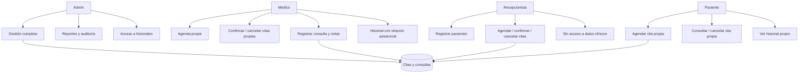

# Caso 2 · Plataforma de Gestión de Consultas Médicas

Aplicación Django 5.2 LTS para la **Práctica Grupal Semana 12** del curso **IS093A (UNCP)**.
Gestiona pacientes, médicos, horarios, citas e historiales clínicos con reglas estrictas de
privacidad y trazabilidad.

> Todos los datos de demostración son ficticios. No corresponden a personas reales.

---

## 1. Objetivo

Organizar la agenda del Centro Médico y el registro de consultas, garantizando:

- identificación válida de pacientes y médicos;
- citas dentro del horario institucional y de la disponibilidad del médico;
- ausencia de superposiciones y de citas duplicadas por paciente/día;
- historiales clínicos inmutables, ampliables solo con notas;
- acceso al historial restringido por rol y relación asistencial;
- auditoría de accesos y operaciones sensibles.

## 2. Roles y permisos

| Rol | Puede hacer |
|---|---|
| **Admin** | Gestiona pacientes, médicos, especialidades, horarios, citas, consultas, reportes y auditoría. |
| **Médico** | Ve su agenda, confirma/cancela sus citas, registra consultas y notas, consulta historiales de pacientes con relación asistencial. |
| **Recepcionista** | Registra y actualiza pacientes, agenda, confirma y cancela citas. **No accede a datos clínicos.** |
| **Paciente** | Agenda sus propias citas, consulta y cancela sus citas, ve su propio historial. |

### Diagrama de roles (Mermaid)



## 3. Funcionalidades principales

- Panel diferenciado por rol con indicadores de agenda.
- Agenda diaria/semanal con filtros por médico, especialidad y estado.
- Registro de pacientes con DNI de 8 dígitos y correo institucional para estudiantes.
- Registro de médicos con CMP de 5 dígitos y especialidad.
- Horarios de atención por médico y día de la semana.
- Agendamiento con franjas de 30 minutos (configurables) y bloqueo transaccional.
- Confirmación y cancelación de citas con auditoría.
- Registro de consulta médica inmutable al completar la atención.
- Notas clínicas posteriores para ampliar información sin editar la consulta.
- Historial clínico con control de acceso y auditoría de cada consulta.
- Reportes de atención y exportación.

## 4. Modelo de datos

| Modelo | Campos relevantes |
|---|---|
| `Especialidad` | nombre único, descripción. |
| `Paciente` | DNI único, nombres, apellidos, fecha de nacimiento, tipo, código UNCP, email, alergias, usuario. |
| `Medico` | nombres, apellidos, CMP único, especialidad, consultorio, activo, usuario. |
| `HorarioAtencion` | médico, día de semana, hora inicio/fin. |
| `Cita` | paciente, médico, especialidad, fecha, hora, motivo, estado. |
| `Consulta` | cita 1:1, diagnóstico, tratamiento, medicamentos, próxima cita, médico. |
| `NotaClinica` | consulta, autor, contenido, fecha. |
| `AuditoriaMedica` | usuario, paciente, acción, fecha, IP, recurso. |

Estados de cita: `pendiente`, `confirmada`, `completada`, `cancelada`.
Solo `pendiente` y `confirmada` se consideran activas y bloquean la franja.

## 5. Reglas de negocio implementadas

1. **DNI**: exactamente 8 dígitos, único.
2. **CMP**: exactamente 5 dígitos, único.
3. **Fecha de nacimiento** no puede ser futura.
4. **Correo institucional** `@uncp.edu.pe` obligatorio para pacientes de tipo estudiante.
5. **Motivo de consulta** de al menos 20 caracteres, sin HTML.
6. **Horario institucional**:
   - lunes a viernes: 08:00–18:00;
   - sábados: 08:00–13:00;
   - domingos: cerrado.
7. **Franjas de 30 minutos** (`CITA_DURACION_MINUTOS`, configurable).
8. **No superposición** de citas activas del mismo médico.
9. **Una cita activa por paciente y día**.
10. **No se agendan citas en fechas pasadas** ni horarios ya transcurridos.
11. **Solo citas confirmadas** permiten registrar consulta.
12. **Solo el médico de la cita** registra la consulta (admin puede hacerlo excepcionalmente).
13. **Las consultas son inmutables**: no se editan; se amplían con notas clínicas.
14. **Historial**: el paciente ve el suyo; el médico requiere `ver_historial_clinico` y relación asistencial; la recepción nunca accede a datos clínicos.
15. **Sesión de 20 minutos** de inactividad.
16. **Auditoría** de agenda, cancelación, confirmación, consulta, nota, historial, login/logout y accesos denegados.

## 6. Seguridad y middleware

- `ActividadSesionMiddleware`: cierre por 20 minutos de inactividad.
- `AlertaCitasMiddleware`: recordatorios y contadores de agenda.
- `ValidacionHorarioMiddleware`: rechazo temprano de peticiones fuera de horario cuando aplica.
- `AuditoriaMedicaMiddleware`: registra 403 y eventos de acceso.
- Cookies `HttpOnly`, `SameSite=Lax`, CSRF y `X-Frame-Options: DENY`.
- Variables para HTTPS: `DJANGO_SECURE_COOKIES=1`, `DJANGO_SSL_REDIRECT=1`.
- Separación estricta entre datos administrativos y datos clínicos.

## 7. Instalación y ejecución

Requisitos: **Python 3.12+** y **Django 5.2 LTS**.

```powershell
# Desde practica_semana12/caso2_consultas_medicas
python -m venv .venv
.\.venv\Scripts\Activate.ps1
pip install -r requirements.txt
python manage.py migrate
python manage.py crear_datos_demo
python manage.py runserver 8002
```

Abrir <http://127.0.0.1:8002/>.

Scripts generales:

```powershell
.\instalar.ps1
.\iniciar_caso2.ps1
```

## 8. Credenciales de demostración

Contraseña única: **`Demo12345!`** (configurable con `DEMO_PASSWORD`).

| Usuario | Rol |
|---|---|
| `admin_medico` | Admin |
| `recepcion1` | Recepcionista |
| `medico1`, `medico2`, `medico3`, `medico4`, `medico5`, `medico6`, `medico7`, `medico8` | Médico |
| `paciente1`, `paciente2`, `paciente3`, `paciente4`, `paciente5`, `paciente6`, `paciente7`, `paciente8`, `paciente9`, `paciente10`, `paciente11`, `paciente12`, `paciente13`, `paciente14`, `paciente15` | Paciente |

> Cada nombre es una cuenta independiente. Use el usuario exacto (`medico1`), no rangos
> como `medico1-8`.

## 9. Datos de demostración

El comando `python manage.py crear_datos_demo` genera:

- 5 especialidades;
- 8 médicos con horarios;
- 15 pacientes ficticios;
- 30 citas en distintos estados;
- 10 consultas con notas clínicas;
- 25 usuarios en total.

Es **idempotente** y no crea datos reales.

## 10. Rutas principales

| Ruta | Descripción |
|---|---|
| `/` | Inicio / redirección |
| `/login/`, `/logout/` | Autenticación |
| `/dashboard/` | Panel por rol |
| `/agenda/` | Agenda de citas |
| `/citas/nueva/` | Agendar cita |
| `/citas/<id>/` | Detalle de cita |
| `/citas/<id>/consulta/` | Registrar consulta |
| `/historial/<paciente_id>/` | Historial clínico autorizado |
| `/pacientes/`, `/medicos/` | Gestión de personas |
| `/reportes/` | Reportes |
| `/admin/` | Administración Django |

## 11. Pruebas automatizadas

```powershell
python manage.py check
python manage.py makemigrations --check --dry-run
python manage.py test consultas -v 2
```

Cobertura funcional (65 pruebas):

- validadores de DNI, CMP, correo y fechas;
- horarios generales y por médico;
- superposición de citas y duplicado paciente/día;
- ciclo de vida de la cita;
- inmutabilidad de consultas y notas;
- autorización de historiales por rol y relación;
- sesión de 20 minutos;
- vistas y admin.

> El resultado real se registra en `../RESULTADOS_PRUEBAS.md`. No se incluyen capturas inventadas.

## 12. Estructura del proyecto

```
caso2_consultas_medicas/
├── config/
├── consultas/
│   ├── management/commands/crear_datos_demo.py
│   ├── migrations/
│   ├── admin.py
│   ├── forms.py
│   ├── horarios.py          # reglas de agenda centralizadas
│   ├── middleware.py
│   ├── models.py
│   ├── permissions.py
│   ├── services.py
│   ├── tests.py
│   ├── urls.py
│   ├── utils.py
│   ├── validators.py
│   └── views.py
├── static/                   # Bootstrap local + CSS propio
├── templates/
├── logs/
├── manage.py
├── requirements.txt
└── README.md
```

## 13. Limitaciones y decisiones

- No se almacenan archivos clínicos reales; solo referencias simuladas.
- No se integra pasarela de correo ni SMS; el backend de correo es de consola.
- SQLite es suficiente para la práctica.
- Las capturas y el informe final se completan manualmente.
- Decisiones ampliadas en `../DECISIONES_TECNICAS.md`.
