# Caso 3 · Plataforma de Control de Asistencia y Permisos

Aplicación Django 5.2 LTS para la **Práctica Grupal Semana 12** del curso **IS093A (UNCP)**.
Controla marcaciones de entrada/salida, horas extra, correcciones auditadas, permisos,
vacaciones y aprobaciones con alcance por área.

> Todos los datos de demostración son ficticios y no corresponden a personas reales.

---

## 1. Objetivo

Automatizar el control de asistencia de una empresa y el flujo de permisos/vacaciones:

- marcación diaria de entrada y salida;
- cálculo automático de horas trabajadas y horas extra;
- correcciones exclusivas de Recursos Humanos, justificadas y auditadas;
- solicitudes de permisos y vacaciones con saldo anual;
- aprobación por el jefe del área o RRHH, sin autoaprobación;
- acceso a la información según el área del usuario;
- sesión de 45 minutos y trazabilidad completa.

## 2. Roles y permisos

| Rol | Puede hacer |
|---|---|
| **RRHH** | Corrige asistencias, aprueba/rechaza solicitudes de toda la empresa, gestiona empleados, reportes y auditoría. |
| **Jefe de área** | Consulta asistencia y solicitudes de su área, aprueba/rechaza solicitudes de su equipo (nunca la propia). |
| **Empleado** | Marca su asistencia, consulta sus registros y crea/consulta sus solicitudes. |
| **Contador** | Consulta empleados, asistencias y reportes en modo solo lectura. |
| **Administrador** | Acceso integral al sistema y al panel de Django. |

### Diagrama de roles (Mermaid)

```mermaid
flowchart TD
    RRHH[RRHH] --> R1[Corregir asistencias]
    RRHH --> R2[Aprobar solicitudes de toda la empresa]
    RRHH --> R3[Gestionar empleados]
    RRHH --> R4[Reportes y auditoría]

    J[Jefe de área] --> J1[Ver asistencia de su área]
    J --> J2[Aprobar solicitudes de su área]
    J --> J3[No puede aprobar la propia]

    E[Empleado] --> E1[Marcar entrada/salida]
    E --> E2[Ver sus registros]
    E --> E3[Crear y cancelar sus solicitudes]

    C[Contador] --> C1[Consultar asistencias]
    C --> C2[Reportes de horas y extras]
    C --> C3[Sin edición]

    A[Administrador] --> A1[Acceso integral]
    A --> A2[Admin Django]
```



## 3. Funcionalidades principales

- Panel con marcación del día, saldo anual y solicitudes recientes.
- Marcación de entrada/salida con validaciones de secuencia y fechas.
- Cálculo automático de horas trabajadas y extra (jornada base de 8 horas).
- Historial personal de marcaciones.
- Registro y consulta de asistencia con alcance por rol/área.
- Corrección de asistencia exclusiva de RRHH, con justificación ≥ 50 caracteres.
- Solicitudes de permiso y vacaciones con validación de fechas, superposición y saldo.
- Flujo de aprobación/rechazo con comentario y auditoría.
- Cancelación de solicitudes pendientes por el solicitante o RRHH.
- Gestión de empleados con DNI y correo corporativo.
- Reportes por área, horas, extras y solicitudes.
- Admin Django personalizado con acciones de aprobación y solo lectura de auditoría.

## 4. Modelo de datos

| Modelo | Campos relevantes |
|---|---|
| `Area` | nombre único, código único, jefe. |
| `Empleado` | DNI único, nombres, apellidos, email corporativo único, cargo, área, usuario, fecha de ingreso, activo, sueldo referencial. |
| `RegistroAsistencia` | empleado, fecha, hora de entrada/salida, observación, usuario que registró. Único por empleado/día. |
| `CorreccionAsistencia` | registro, horas anteriores/nuevas, justificación, corregido por, fecha. Inmutable. |
| `Solicitud` | empleado, tipo, fechas, motivo, estado, revisado por, fecha y comentario de revisión. |
| `AuditoriaAsistencia` | usuario, empleado, acción, fecha, IP, detalle. |

Estados de solicitud: `pendiente`, `aprobada`, `rechazada`, `cancelada`.
Tipos: `permiso`, `vacaciones`.

## 5. Reglas de negocio implementadas

1. **DNI** de 8 dígitos, único.
2. **Correo corporativo** obligatorio con dominio `@tecnoandes.pe`.
3. **Fecha de ingreso** no puede ser futura.
4. **Una marcación por empleado y día** (restricción única en base de datos).
5. **La salida debe ser posterior a la entrada**; no se registra salida sin entrada.
6. **Horas trabajadas** calculadas dinámicamente; **extra = total − 8 h** cuando supera la jornada.
7. **Solo RRHH corrige asistencias** y debe justificar con **≥ 50 caracteres**.
8. **Las correcciones son inmutables**; una nueva corrección genera otro registro.
9. **Solicitud inicia en día hábil** (lunes a viernes) y no en fecha pasada.
10. **Motivo de solicitud ≥ 20 caracteres**, sin HTML.
11. **No se permiten solicitudes superpuestas** activas del mismo empleado.
12. **Saldo anual de 30 días hábiles** compartido entre permisos y vacaciones aprobados.
13. **Aprobación solo por RRHH o jefe del área del empleado**.
14. **Nadie puede aprobar su propia solicitud** (incluido RRHH y superusuario).
15. **Solicitudes resueltas no se vuelven a resolver**.
16. **Alcance por área**: el jefe solo ve su área; RRHH/Contador ven toda la empresa.
17. **Sesión de 45 minutos** de inactividad.
18. **Auditoría** de marcación, corrección, solicitud, aprobación, rechazo, cancelación, login/logout y accesos denegados.

## 6. Seguridad y middleware

- `ActividadSesionMiddleware`: cierre por 45 minutos de inactividad.
- `AlertaSolicitudesMiddleware`: contador de pendientes para jefes/RRHH.
- `AuditoriaAsistenciaMiddleware`: registra respuestas 403 y eventos de acceso.
- Cookies `HttpOnly`, `SameSite=Lax`, CSRF y `X-Frame-Options: DENY`.
- Variables para HTTPS: `DJANGO_SECURE_COOKIES=1`, `DJANGO_SSL_REDIRECT=1`.
- Separación de alcance por área en consultas y validaciones de objeto.

## 7. Instalación y ejecución

Requisitos: **Python 3.12+** y **Django 5.2 LTS**.

```powershell
# Desde practica_semana12/caso3_asistencia
python -m venv .venv
.\.venv\Scripts\Activate.ps1
pip install -r requirements.txt
python manage.py migrate
python manage.py crear_datos_demo
python manage.py runserver 8003
```

Abrir <http://127.0.0.1:8003/>.

Scripts generales:

```powershell
.\instalar.ps1
.\iniciar_caso3.ps1
```

## 8. Credenciales de demostración

Contraseña única: **`Demo12345!`** (configurable con `DEMO_PASSWORD`).

| Usuario | Rol |
|---|---|
| `admin_asistencia` | Administrador |
| `rrhh1` | Recursos Humanos |
| `jefe_ti`, `jefe_rrhh`, `jefe_contab`, `jefe_oper` | Jefe de área |
| `contador1` | Contador |
| `empleado1`, `empleado2`, `empleado3`, `empleado4`, `empleado5`, `empleado6` | Empleado |

> Cada nombre es una cuenta independiente. Use el usuario exacto (`empleado1`), no rangos
> como `empleado1-6`.

## 9. Datos de demostración

`python manage.py crear_datos_demo` genera:

- 4 áreas (TI, RRHH, Contabilidad, Operaciones);
- 12 empleados;
- 75 registros de asistencia de días hábiles recientes;
- 1 corrección auditada;
- 4 solicitudes (aprobada, pendientes y rechazada);
- 13 usuarios en total.

El comando es **idempotente** y puede ejecutarse nuevamente.

## 10. Rutas principales

| Ruta | Descripción |
|---|---|
| `/` | Inicio / redirección |
| `/login/`, `/logout/` | Autenticación |
| `/dashboard/` | Panel por rol |
| `/asistencia/marcar/` | Registrar entrada o salida |
| `/asistencia/mis-registros/` | Historial propio |
| `/asistencia/registros/` | Asistencia según alcance |
| `/asistencia/<id>/corregir/` | Corrección (solo RRHH) |
| `/solicitudes/` | Listado de solicitudes |
| `/solicitudes/nueva/` | Crear solicitud |
| `/solicitudes/<id>/` | Detalle y acciones |
| `/empleados/` | Empleados según alcance |
| `/reportes/` | Reportes agregados |
| `/admin/` | Administración Django |

## 11. Pruebas automatizadas

```powershell
python manage.py check
python manage.py makemigrations --check --dry-run
python manage.py test asistencia -v 2
```

Cobertura funcional (61 pruebas):

- validaciones de DNI, correo y fecha de ingreso;
- cálculo de jornada y horas extra;
- marcación de entrada/salida y duplicados;
- corrección exclusiva de RRHH, justificación mínima e inmutabilidad;
- reglas de solicitud, días hábiles, superposición y saldo de 30 días;
- aprobación por jefe/RRHH, denegación entre áreas y autoaprobación;
- alcance por área en vistas;
- sesión de 45 minutos;
- admin y acciones masivas.

> El resultado real se registra en `../RESULTADOS_PRUEBAS.md`. No se incluyen capturas inventadas.

## 12. Estructura del proyecto

```
caso3_asistencia/
├── config/
├── asistencia/
│   ├── management/commands/crear_datos_demo.py
│   ├── migrations/
│   ├── admin.py
│   ├── context_processors.py
│   ├── forms.py
│   ├── middleware.py
│   ├── models.py
│   ├── permissions.py
│   ├── reglas.py            # reglas laborales centralizadas
│   ├── services.py
│   ├── tests.py
│   ├── urls.py
│   ├── utils.py
│   ├── validators.py
│   └── views.py
├── static/                   # Bootstrap local + CSS propio
├── templates/
├── logs/
├── manage.py
├── requirements.txt
└── README.md
```

## 13. Limitaciones y decisiones

- Las horas se calculan en tiempo de consulta; no se almacenan para evitar inconsistencias.
- No se integra reloj biométrico ni dispositivo físico.
- SQLite es suficiente para la práctica.
- El backend de correo es de consola.
- Las capturas y el informe final se completan manualmente.
- Decisiones ampliadas en `../DECISIONES_TECNICAS.md`.
